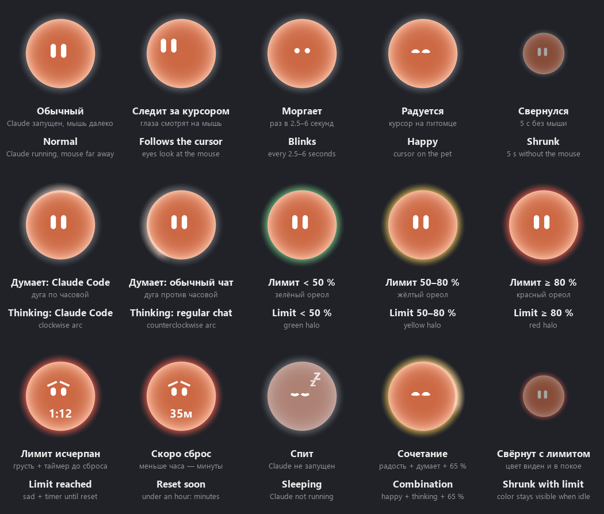

# Питомец Claude

[English](README.md) | **Русский**

Маленький питомец на рабочем столе Windows для приложения Claude и Claude Code. Это круглая мордочка поверх всех окон: она показывает, что Claude думает над ответом, сколько израсходовано лимита подписки и запущен ли Claude вообще.



## Что умеет

- **Клик** разворачивает Claude. Если Claude уже активен, сворачивает его, а если не запущен — запускает.
- **Перетаскивание** левой кнопкой мыши перемещает питомца по экрану.
- **Покой.** Если мышь далеко, питомец сворачивается в полупрозрачный шарик, а при наведении снова разворачивается. Глаза следят за курсором и иногда моргают.
- **Claude думает.** Пока Claude Code работает над ответом, по ореолу бежит светящаяся дуга по часовой стрелке. В обычном чате дуга бежит против часовой.
- **Цвет ореола** показывает расход лимита подписки: зелёный — меньше 50 %, жёлтый — до 80 %, красный — 80 % и больше.
- **Лимит исчерпан.** Питомец грустит, а на мордочке идёт таймер до сброса.
- **Сон.** Если Claude не запущен или не активен 3 минуты, питомец засыпает.
- **Подсказка при наведении:** лимиты за 5 часов и за неделю, заполнение контекста, токены, дата продления подписки.
- **Уведомления-пузыри:** при 80 % и 95 % лимита, при сбросе лимита, при заполненном контексте и перед продлением подписки.
- **Меню по правой кнопке:**
  - быстрые ссылки в Claude: новый чат, недавние чаты, проекты, задачи, коннекторы, настройки;
  - Claude Code: новая сессия, последняя сессия, сессии, ждущие ответа, поиск;
  - папки проектов;
  - статистика;
  - размер питомца;
  - автозапуск вместе с Windows.

## Требования

- Windows 10 или 11.
- Приложение Claude для Windows и/или Claude Code.
- Python 3 с python.org. Галочку *tcl/tk and IDLE* при установке не снимайте. Python из Microsoft Store не подойдёт: он подменяет папку `%APPDATA%` для запускаемых программ.
- Библиотека Pillow.

## Установка

1. Скачайте репозиторий: **Code → Download ZIP**, или так:
   ```
   git clone https://github.com/ARCHERDEV777/claude-desktop-pet.git
   ```
2. Установите зависимости:
   ```
   pip install -r requirements.txt
   ```
3. Запустите **`Start Pet.vbs`** двойным щелчком. Скрипт сам найдёт установленный Python и запустит питомца без окна консоли.

Чтобы питомец стартовал вместе с Windows, включите в его меню пункт **«Запускать вместе с Windows»**.

## Как это работает

| Файл | Назначение |
|---|---|
| `claude_pet.pyw` | Сам питомец: окно, анимация, меню, уведомления. |
| `pet_stats.py` | Сбор статистики: лимиты, токены по журналам Claude Code, папки проектов. |
| `pet_hook.py` | Хук Claude Code. Отмечает, что Claude думает над ответом. |
| `pet_statusline.py` | Status line Claude Code. Сохраняет проценты лимитов и контекста, а заодно выводит их строкой внизу окна Claude Code. |
| `chat_watch.ps1` | Следит за обычным чатом: видна ли в окне Claude кнопка «Остановить ответ». |
| `Start Pet.vbs` | Запуск без консоли с автопоиском Python. |

При запуске питомец сам добавляет свои хуки и status line в `~/.claude/settings.json`. Чужие настройки он не трогает: если у вас уже есть своя status line, он её не заменяет. Если вы перенесли папку питомца, пути в настройках обновятся при следующем запуске. Хуки отключаются пунктами меню «Следить за Claude Code» и «Показывать лимиты подписки».

Настройки и служебные файлы питомца хранятся в `%USERPROFILE%\.claude-desktop-pet`. Если задана переменная `CLAUDE_CONFIG_DIR`, каталог Claude Code берётся из неё.

## Ограничения

- Работает только в Windows.
- Проценты лимитов приходят только на подписках Pro и Max, причём после первого ответа в сессии Claude Code.
- Часть данных питомец читает из внутренних файлов приложения Claude. Их формат не документирован и может измениться после обновления Claude. В этом случае соответствующие показатели просто пропадут, а сам питомец продолжит работать.
- Слежение за обычным чатом узнаёт кнопку остановки ответа только в английском и русском интерфейсе. Для другого языка добавьте название кнопки в `$StopNames` в `chat_watch.ps1`.

## Удаление

1. Снимите в меню галочки «Следить за Claude Code», «Показывать лимиты подписки» и «Запускать вместе с Windows». Так хуки и автозапуск будут убраны.
2. Закройте питомца.
3. Удалите папку питомца и папку `%USERPROFILE%\.claude-desktop-pet`.

## Лицензия

[MIT](LICENSE): можно свободно использовать, изменять и распространять с сохранением имени автора.

---

Неофициальный проект, не связан с Anthropic.
